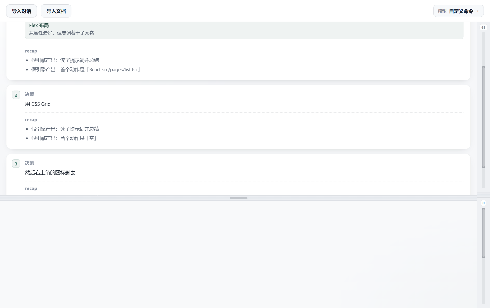
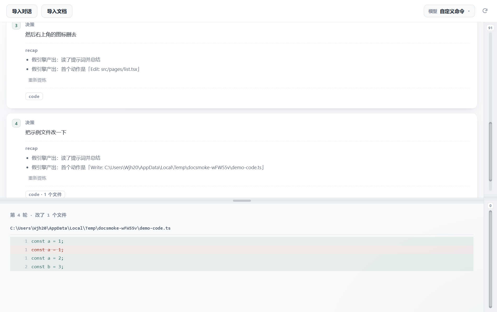

# 双面板 · 共识文档工作台

> 上面是对话，下面是共识文档，中间一条能拖的中缝。
> 应用只做两件事：**把对话导成「决策 + recap」卡片**，**把共识文档原地编辑并写回原文件**。



一个 Electron 桌面应用，给"人和 agent 一起干活"用的：

- **你写的决策，一字不动地被记下来** —— 导入一段对话日志，每轮变成上方一张卡片，
  左边是你当时的原话和 agent 给你的选项，右边是这一轮 agent 干了什么的提炼摘要。
- **共识文档只有一份，写回原路径** —— 下方所见即所得编辑 `.md` / `.txt`，
  存盘就是写回你导入的那个文件。应用不给 agent 开任何 API，
  所以 agent 用自己的 Read 工具读到的永远是最新内容；应用另外监听文件变化，
  agent 在外面改完能自动重载。

---

## 一、下载：三选一

### 方式 A：一键脚本（最省事，推荐第一次用这个）

**Windows**：进到仓库首页 → 右边绿色按钮 **Code** → **Download ZIP** → 解压 →
双击里面的 **`start-here.bat`**。

**macOS / Linux**：同样下载 ZIP → 解压 → 终端里进到解压出来的目录 →

```bash
bash start-here.sh
```

脚本会自己检查 Node.js、装依赖（国内源已配好）、构建、启动，中间不用管。
第一次装依赖要下载 Electron（约 100MB），慢一点是正常的。

> 下载 ZIP 得到的文件夹名字是 `dual-panel-workbench-main`，可以随便改名。

### 方式 B：git clone（以后想更新就用这个）

```bash
git clone https://github.com/Wjh202694/dual-panel-workbench.git
cd dual-panel-workbench/app
npm install
npm start
```

以后更新：`git pull` 然后再 `npm start`。

### 方式 C：手动敲命令

```bash
cd dual-panel-workbench/app
npm install     # 第一次
npm start       # 每次启动（会自动先构建前端）
```

---

## 二、前置条件

| 需要 | 说明 |
|---|---|
| **Node.js 18 或更高** | [nodejs.org](https://nodejs.org/) 下载安装；国内镜像 <https://npmmirror.com/mirrors/node/> |
| 磁盘 500MB+ | Electron 本体约 100MB，加上依赖 |
| 不用装数据库、不用配环境变量 | 首次运行不需要建任何目录 |

**装 Electron 卡住 / 装不上？**（国内常见）Electron 的二进制默认从 GitHub 下载，
连不上就会卡住。用镜像重装：

```bash
cd dual-panel-workbench/app
ELECTRON_MIRROR=https://npmmirror.com/mirrors/electron/ npm install
```

或者直接用 `start-here.bat` / `start-here.sh` —— 脚本在官方源失败时会自动换镜像重试一次。

> **别直接跑 `npx electron .`** —— 前端 bundle 是构建产物，仓库里没有（省得仓库变大）。
> 直接跑会白屏。**用 `npm start`**，它会先构建再启动。

---

## 三、第一次用：怎么打开自己的文档和对话

装好之后，两件事分别这样打开。

### 打开文档（下方那块）

1. 点左上角 **导入文档** → 弹出一份清单，有两个分组：
   - **最近导入**：你以前在这个应用里导入过的文档；
   - **项目文件夹**：从对话日志里的项目路径推出来的目录，里面列着该目录的 `.md` / `.txt`。
2. **新装机器上这两个分组多半是空的**（下面「清单为什么是空的」一节有解释），
   这时点清单底部的 **「浏览其他文件…」** → 弹出系统文件框 → 选你的 `.md` 或 `.txt`（可多选）。
   也能直接选**源代码**：`.py` / `.js` / `.ts` / `.tsx` / `.jsx`（按纯文本打开，改完照样写回原文件）。
3. 选完之后，下方直接就是那个文档的内容，可以像在 Word 里一样改：
   - `.md` 是所见即所得：打 `# ` 出标题、`- ` 出列表、`> ` 出引用、`**文字**` 变粗；
   - 停止输入 0.9 秒就**自动写回你原来那个文件**（原地改，不产生副本）；
   - `Ctrl+S` 立即保存。
4. 一次只能显示一个文档，导入新的会替换旧的（旧的先自动存盘）。

### 打开对话（上方那块）

1. 点左上角 **导入对话** → 弹出一份清单，每条给的是
   **标题**（Claude 给这次对话起的名字）、**项目路径**、多久之前 —— 不是一堆 UUID 文件名。
2. **没装 Claude Code 的话这个清单是空的**，点底部的 **「浏览其他日志…」** →
   系统文件框里选一个 `.jsonl` 文件（Claude Code 的会话日志就在
   `~/.claude/projects/<项目>/<uuid>.jsonl`，Windows 上是 `%USERPROFILE%\.claude\projects\...`）。
3. 每一轮对话变成上方一张卡片：左边是「决策」（你的原话，一字不改 + agent 给你的选项），
   右边是「recap」（这一轮 agent 干了什么的提炼摘要，由提炼引擎生成）。

### 卡片上那个 **code** 按键

每张卡片的 recap 下面还有一节 **code**。它的小标题**是个按键**：

- **不点就不加载** —— 不会去翻日志，也不会白占地方；
- 点一下，才算出这一轮 agent **在哪个文件、哪一行新增了什么、删除了什么**；
- **最左边那列是源文件里的真实行号**：删除行的编号是**改之前**那份文件里的位置，
  新增行的编号是**改之后**那份文件里的位置；文件路径后面还标着「改前 N 行 → 改后 M 行」。
  （行号是把日志里的改动回放一遍、把「这一轮之前」和「这一轮之后」两个版本都还原出来算的，
  不是拿磁盘上那份文件硬凑的 —— 那份文件可能已经是好几轮之后的样子。）
- 结果显示在**下方那块地方**（平时放文档的地方），一次只显示点到的那一轮；
- **万一算不准会明说**：文件后来被整个改写过、那一轮删掉了内容、或者同一段文字在文件里
  出现多次（位置可能对不上）时，那一轮之前的样子就推不出来了 ——
  这时文件路径旁边会标一个「行号是估的」，鼠标停在行号上会说明是哪一种原因；
  实在算不出来的行号就留空，绝不瞎填一个；
- 这一轮没改代码就显示「这一轮没有改文件」；
- 文档还开着的话，代码视图左上角有「回到文档」。



### 对话还在继续写？点右上角的刷新按钮

日志文件是**边聊边追加**的。你导进去之后又聊了几轮，不用重新导入文件 ——
点右上角那个**只有图案、没有文字的圆形箭头按钮**，就会把日志里新长出来的轮次接在下面，
并自动开始提炼。

- **一次最多带出 3 轮**，剩下的再点一次继续带（免得一口气把免费模型额度打爆）。
- 没有新轮次时会明确告诉你「没有新的对话」，不会看着像卡住。
- 按钮在**模型按键的右边**，刷新期间会转一圈。

### 清单为什么是空的？

| 清单 | 数据从哪来 | 空了怎么办 |
|---|---|---|
| 导入对话 | 扫本机 `~/.claude/projects` 下的 Claude Code 会话日志 | 没装 Claude Code 就是空的 → 点「浏览其他日志…」手动选 |
| 导入文档 · 最近导入 | 应用自己记下的导入历史（存在 `settings.json` 里） | 导入过一次文档之后就有了 |
| 导入文档 · 项目文件夹 | 从对话日志里的项目路径（`cwd`）推出来的目录 | 同样靠「浏览其他文件…」手动选 |

**一个要注意的限制**：目前**不能指定一个工作目录**，只能选具体的文件。
「项目文件夹」那一组是从对话日志里推出来的，不是你自己指定的工作区。

---

## 四、recap 出不来？先看提炼引擎

recap 是提炼引擎生成的。引擎有四档，在**菜单「工具 → 自定义模型与命令…」**里换：

| 引擎 | 你机器上需要什么 |
|---|---|
| **opencode**（默认） | 装了 [opencode](https://opencode.ai) CLI，且在 `PATH` 里 |
| Claude Code CLI | 装了 Claude Code CLI，且在 `PATH` 里 |
| 自定义命令 | 任意命令：提示词从 **stdin** 进，要点从 **stdout** 出 |
| **API 调用** | 只要一个接口地址 + Key + 模型名（**什么都不用装**） |

**没装 opencode 的话**，导入对话照样能用，只是每张卡片的 recap 会失败，
显示「提炼失败：引擎退出码 1：'opencode' 不是内部或外部命令」。
（Windows 上这句 cmd 的报错是 GBK 编码，有时在界面上会显示成乱码，意思就是这个。）

**不想装任何 CLI，就想用 API**：菜单「工具 → 自定义模型与命令…」→ 引擎选 **API 调用** →
填「API 地址 / API Key / 模型名 / 接口格式（OpenAI 兼容 或 Anthropic）」：

- 地址填到 `/v1` 或不填都行，程序会自己补；
- 填错了会当场在对应输入框下面红字说明，**不会把错配置存下去**；
- 有个 **「测试连接」** 按钮，用当前填的值真跑一次，成功显示返回样例、失败显示具体原因。

右上角那个 **模型** 按键可以直接在几个免费模型之间切（opencode 的免费模型），
切换立刻生效。

---

## 五、它会往你机器上写什么

| 写在哪 | 是什么 | 能删吗 |
|---|---|---|
| `%APPDATA%\dual-panel-doc-app\settings.json`（Windows）<br>`~/Library/Application Support/dual-panel-doc-app/`（macOS） | 引擎设置 + 「最近导入」清单 | 能，删了会回到默认 |
| **你选的对话日志旁边**，`<日志名>.recap.md` | 提炼出来的 recap，既是产物也是缓存 | 能。删了下次会重新提炼 |
| `app/src/renderer/bundle.js` | 前端构建产物 | 能，`npm run build` 会重新生成 |

recap 是**写在原日志旁边**的 —— 也就是说它会往你的 `~/.claude/projects` 目录里写文件。
介意的话把引擎换成本地脚本（自定义命令），内容就不会出你的机器。

---

## 六、常见问题

**Q：启动后一片空白？**
A：多半是直接跑了 `npx electron .`。用 `npm start`（会先构建）。已经构建过的话，
`npm run build && npx electron .` 也行。

**Q：`npm install` 卡在 electron 那里不动？**
A：换镜像，见上面「二、前置条件」。

**Q：装完 `npm start` 报「'electron' 不是内部或外部命令」？**
A：Electron 没装上（下载失败）。用镜像重装：
`ELECTRON_MIRROR=https://npmmirror.com/mirrors/electron/ npm install`

**Q：导入的 txt 中文是乱码 / 字被裁掉？**
A：这个已经处理过了：自动识别 UTF-8 / UTF-8-BOM / UTF-16LE / UTF-16BE / GBK，
写回时用原编码；字体栈里补了中文字体，不会再退回宋体。

**Q：Mac / Linux 能用吗？**
A：代码里没有写死 Windows 的地方（路径、编码都是跨平台的），macOS / Linux 上
`npm install && npm start` 理论上能跑。但作者只在 Windows 上验证过，
遇到问题请开 issue。

**Q：想跑一遍自检？**
A：`cd app && npm test`。它先跑两个纯计算的自检（行级 diff、回放算法，共 111 项断言，
不开窗口），再真的开一个窗口、用临时目录里的合成文件跑端到端自检（92 项断言），不联网，
不会碰你的任何真实文件。（自检里有一两条断言依赖本机装了 Claude Code，
没装的话那两条会以"空态提示"的方式通过。）

---

## 目录

```
.
├── app/                     Electron 应用本体
│   ├── src/
│   │   ├── main.js          主进程：窗口、文件读写、外部改动监听、菜单
│   │   ├── preload.js       渲染层能用的能力（最小暴露面）
│   │   ├── conv/            导入对话这条线
│   │   │   ├── parse-log.js   JSONL → 一轮轮对话
│   │   │   ├── distill.js    提炼引擎（提示词走 stdin）
│   │   │   ├── cache.js      recap 缓存（写回日志旁边）
│   │   │   ├── models.js     可切换的模型预设
│   │   │   ├── recent.js     最近会话清单（带标题的那种）
│   │   │   ├── code-diff.js  这一轮改了哪些代码（编排）
│   │   │   ├── code-state.js 回放改动、算行号（纯计算）
│   │   │   └── linediff.js   行级 diff（纯计算）
│   │   ├── doc/             文档相关（编码、最近导入）
│   │   ├── src/ 顶层的公共模块：settings.js / engines.js / format.js /
│   │   │   paths.js / text-file.js（谁都能用，互相不依赖）
│   │   ├── renderer/        界面（无框架，esbuild 打包）
│   │   ├── picker.html/js   「有名字的清单」选择器窗口
│   │   └── engine-dialog.*  引擎设置小窗口
│   └── test/                端到端自检 + 单元自检 + 合成日志 + 假引擎
├── demo/                    最初的纯静态线框 Demo（双击 index.html 就能看）
├── assets/                  AI 生成的图像素材（备用的，App 里没引用）
├── docs/                    截图
├── start-here.bat           Windows：一键装好并启动
├── start-here.sh            macOS / Linux：一键装好并启动
└── ui-preview.png
```

## 界面约束

界面是按手绘草图定的，所以加东西之前先想清楚：

- **两个面板本身**跟 Demo 一致：上方是 8 张空白卡片（导入对话后被对话卡片替换），
  右侧两条独立滚动条，中缝可拖，默认黄金分割 φ = 1.618
- **下方不出现任何"这是哪个文档"的信息** —— 没有标签栏、工具栏、路径状态栏、保存状态胶囊
- 顶栏：左边「导入对话 / 导入文档」两个按钮，右上角一个「模型」切换按键 + 一个刷新图标

引擎设置、模型清单这些都放在**独立小窗口**里，主界面不脏。

## 许可

MIT
