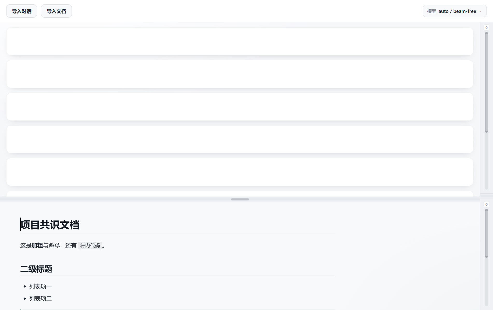

# 双面板 · 共识文档工作台

> 这是**开发者文档**。只想用这个应用、或者要在自己机器上装起来，
> 看仓库根目录的 [README.md](../README.md) —— 那里有下载方式、一键安装脚本、
> 和"怎么打开自己的文档和对话"的分步操作。

把原来的静态 Demo 升级成真正的桌面软件（Electron）。下半区是**人和 agent 共用的共识文档区**：
项目文档、设计文档、产品需求文档、AGENTS.md —— 人在应用里改，agent 直接读同一份文件。



---

## 跑起来

```bash
cd app
npm install          # 首次
npm start            # 构建渲染层 + 启动应用
```

启动时也可以直接带上要导入的对话日志：

```bash
npx electron . --conv "~/.claude/projects/<项目slug>/<uuid>.jsonl"
```

（`--conv` 可以给多个。启动参数带日志时，窗口一开就自动导入并开始提炼。）

其它命令：

```bash
npm run build        # 只构建渲染层（esbuild 打包到 src/renderer/bundle.js）
npm run watch        # 改代码时自动重建
npm run test:unit    # 纯计算的自检（行级 diff + 回放算法，不开窗口）
npm test             # 单元自检 + 端到端自检（导入→渲染→写回→外部改动→GBK 往返）
```

首次 `npm install` 后如果 Electron 没装上（国内网络常见），手动补一次：

```bash
ELECTRON_MIRROR=https://npmmirror.com/mirrors/electron/ npx install-electron
```

---

## 现在能做什么

两个面板与原 Demo 完全一致：上方一列空白卡片、下方文档区、右侧两条独立滚动条。
**下方不显示任何与"这是哪个文档"有关的信息**——没有文件名、路径、大小、编码、标签栏、工具栏。
顶栏是「导入对话 / 导入文档」两个按钮 + 右上角一个「模型」切换按键 + 一个**刷新图标**。

| 操作 | 行为 |
|---|---|
| 顶栏「导入文档」 | 先弹**有名字的清单**（「最近导入」+「项目文件夹」），清单里可点「浏览其他文件…」回到系统文件框；只接受 `.txt` / `.md` / `.markdown`，其它格式会被跳过并提示 |
| 导入新文档 | **替换**当前文档（当前文档会先自动存盘），下方只显示这一个文档 |
| 编辑 `.md` | **所见即所得**：标题、加粗、斜体、删除线、列表、引用、代码块、表格、分割线都直接生效，排版所见即所得，磁盘上仍是干净的标准 Markdown |
| 改格式 | 在行首打 `# `（标题）、`- `（列表）、`> `（引用）自动变成排版；`**文字** 变粗体；`Ctrl+B` / `Ctrl+I` 也可用 |
| 编辑 `.txt` | 纯文本模式，等宽字体 |
| 停止输入 0.9 秒 | **自动写回原始文件**（原地编辑，不产生副本） |
| `Ctrl+S` | 立即保存 |
| agent 在应用外改了这个文件 | 本地无未保存改动 → **自动重新载入**；本地有未保存改动 → 弹出横幅让你选「重新载入」还是「用我的版本覆盖」 |
| 顶栏「导入对话」 | 先弹**有名字的清单**（标题 / 项目路径 / 多久之前），可点「浏览其他日志…」回到系统文件框选 `.jsonl`；每轮对话变成上方一张卡片 |
| 顶栏的**刷新图标** | 把日志里**新长出来的轮次**接在下面（一次最多 3 轮），不用重新导入文件 |
| 卡片上的 **code 按键** | 点一下才加载这一轮改了哪些代码，改动显示在**下方那块地方**（原来放文档的位置） |
| 拖动中间分割线 | 自由调整上下高度比，默认黄金分割 φ = 1.618，双击复位 |
| 右侧窄栏 | 上下两条**独立**滚动条，可拖滑块、点轨道跳转、滚轮、键盘操作 |

应用菜单里还有「在文件夹中显示」「复位面板比例」「提炼缺失的 recap」「提炼引擎」，都是不占界面的入口。

---

## 怎么找得到要导入的文件

对话日志的文件名是 UUID（`43f3a5f6-aa66-….jsonl`），项目文档散在各个文件夹里 —— 让人在文件框里靠肉眼认，是没道理的。
所以两个「导入」按钮都先弹一份**有名字的清单**，认完再选：

**导入对话** → 清单按最近修改排序，每一条给：

| 显示的东西 | 哪来的 |
|---|---|
| 标题（如「双面板滚动UI-Demo 文档导入」） | 日志里的 `type:"ai-title"` 记录 |
| 项目路径 | 日志里的 `cwd` |
| 首句提示词 | 日志里第一条人写的消息 |
| 多久之前 · 多大 | 文件修改时间与大小 |

**导入文档** → 两组：

- **最近导入**：你导入过的文档，下次直接点
- **项目文件夹**：从对话日志的 `cwd` 推出项目目录，把里面的 `.md` / `.txt` 列出来

两个清单都还有「浏览其他文件…」回到系统文件框，以及双击直接打开。

---

## 导入对话

选一个对话日志（Claude Code 的 `.jsonl` 就行），应用把它切成一轮轮对话，每轮变成上方一张卡片：

```
┌──────────────────────────────────────────┐
│ ①  决策                                   │
│    把这个页面改成双栏布局，左边列表右边详情   │  ← 你的原话，一个字都不改
│    ┌ CSS Grid ─ 改动最小，只动样式文件 ┐   │  ← agent 当初给你的选项
│    └ Flex 布局 ─ 兼容性最好            ┘   │
│    ────────────────────────────────      │
│    recap                                  │
│    · 读取了 src/pages/list.tsx 查看代码    │  ← 这一轮 agent 干了什么
│    · 在代码库中搜索了 layout 关键词         │     （由提炼引擎生成）
│    · 通过 AskUserQuestion 澄清需求         │
└──────────────────────────────────────────┘
```

- **决策**：日志里你的提示词**原文照抄**，外加当时 agent 问你的选项（`AskUserQuestion` 的选项）。
  系统生成的噪音（`<command-name>`、`<task-notification>`、工具返回结果、子代理对话）会被滤掉。
- **recap**：这一轮 agent 执行的动作序列 + 它的回复，交给**提炼引擎**压成 2~5 条要点。
- **code**：这一轮 agent 改了哪些文件、哪一行新增了什么、删除了什么。
  **小标题是个按键，点一下才加载**（渐进式披露：几十轮对话一进来就翻日志太浪费，
  所以没点过的轮次一律不动）。加载完的改动显示在**下方那块地方** —— 也就是平时放文档的位置，
  一次只显示点到的那一轮；文档还开着的话，代码视图左上角有「回到文档」。

### 「code」小节：点一下才看这一轮改了什么

每张卡片的 recap 下面多一节 **code**。它的**小标题是个按键**，不是普通标题：

- **不点就不加载** —— 几十轮对话进来时不会去翻日志、也不会去算行号；
- 点一下才去读日志里这一轮的工具调用（`Write` / `Edit` / `MultiEdit` / `NotebookEdit`），
  算出「哪个文件、哪一行、新增了什么、删除了什么」；
- 结果显示在**下方那块地方**（平时放文档的那块），一次只显示点到的那一轮；
- 这一轮没改代码就显示「这一轮没有改文件」，不会留着上一轮的内容；
- 文件已经不在了，或者这一轮之前的内容算不出来，
  就标一个「这一轮的行号算不出来」或「行号是估的」的提示，改动内容照样显示。

#### 行号是怎么来的

日志里记的是**改动的文本**，不是行号。行号是**回放**出来的（`app/src/conv/code-state.js`）：

回放有两条路，能走哪条走哪条（先试正着，试不通再试倒着）：

1. **正着回放** —— 目标轮之前有过 `Write`（写文件就是整个替换，内容是确定的），
   就从那次 `Write` 的内容一路正着放到目标轮；
2. **倒着撤** —— 没有 `Write`，就拿磁盘上那份最终内容**倒着撤**
   （把新文本换回旧文本）到目标轮。

正着回放优先，因为它只靠日志，反映的是「agent 当时干了什么」，
文件后来在别处被谁改过都不影响；倒着撤锚在真实的磁盘内容上，日志里没有锚点时用它。

两条路都会得出「这一轮之前」和「这一轮之后」两个版本的文件内容，
再拿这两个版本做行级 diff（`app/src/conv/linediff.js`，LCS 对齐）：

- **删除行**的行号 = 它在**旧版本**里是第几行；
- **新增行**的行号 = 它在**新版本**里是第几行。

两个版本各算各的，所以「删掉 1 行、加上 3 行」这种改动，
左边显示的是旧文件的第 3 行，右边是新文件的第 3、4、5 行 —— **都是源文件里的真实行号**。

为什么不直接拿磁盘上那份算：它可能已经是好几轮之后的样子，
文本根本对不上（对不上时那一列就空了），或者对上了却是错的行号。

**唯一的假设**：目标轮本身就是那次 `Write`（也就是这个文件在日志里的第一次出现）时，
「这一轮之前」按「文件本来不存在」算 —— 日志里看不出来在那之前文件有没有内容。
除此之外，「改前」「改后」两版内容都是推出来的，不是猜的。

**撤不动的时候**（会标在文件路径旁边，写明是哪一种原因）：

| 情况 | 结果 |
|---|---|
| 文件后来被整个 `Write` 覆盖过 | 那一轮之前的内容无从得知 → 行号按当前文件估 |
| 那一轮里把整个文件重写了 | 同上（改之前的内容无从得知） |
| 那一轮删掉了内容 | 删之前的样子撤不回来 → 行号按当前文件估 |
| 改动的那段文字在文件里不唯一 | 位置可能对不上 → 标成「行号是估的」 |
| 磁盘上的内容跟日志对不上（文件后来在别处被改过） | 行号按当前文件估 |
| 改的是 notebook | 内容没法按行算 |

「不唯一」这一条**两条路都查**：正着回放时查旧文本在文件里出现几次，
倒着撤时既查撤回去时找的那段新文本出现几次，也查旧文本在「改前」那份内容里出现几次 ——
只要有一处说不准，就标成「行号是估的」，不装作精确。

估算模式下，**删除行和新增行各找各的位置**，绝不拿新增行的编号冒充删除行的编号；
找不到就留空，并在旁边标「这一轮的行号算不出来」。

### 能导入哪些文件

`.txt` / `.md` / `.markdown`，加上 **5 种主流源代码**：`.py`、`.js`、`.ts`、`.tsx`、`.jsx`。

源代码按**纯文本**处理（等宽字体、不走 Markdown 排版），和 txt 一样能直接改、能自动写回原文件。
（扩展名集合只有一处：`app/src/doc/recent.js` 里的 `DOC_EXT`，main.js 直接引用它。）

---

### 提炼引擎

默认用 **opencode 的免费模型**（`magpie/auto/beam-free`）。引擎在**菜单「工具」**里换：

| 引擎 | 说明 |
|---|---|
| opencode | `opencode run -m <模型> --format json`，默认走免费模型 |
| Claude Code CLI | `claude -p` |
| 自定义命令 | 任意命令，**从 stdin 读提示词、stdout 输出要点** |
| API 调用 | 任何 OpenAI 兼容 / Anthropic 接口，填地址 + Key + 模型名 |

「工具 → 自定义模型与命令…」会弹一个独立的小设置窗口（不动主界面）。

### 引擎设置窗口（填错了会当场告诉你）

窗口里**字段跟着引擎走**：选 opencode 只显示「模型」，选自定义命令多一行命令，选 API 调用才出现
「API 地址 / API Key / 接口格式」。

- **保存前逐项校验**，哪里不对就在哪个输入框下面显示红色说明，并把焦点挪到第一个出错的字段：
  地址不以 `http://` / `https://` 开头、Key 没填、模型名没填、命令没填 —— 都会被拦下，
  **填错的配置不会存进去**。
- 有个 **「测试连接」** 按键：用当前输入框里的值真跑一次引擎（不保存），
  成功显示引擎返回的样例，失败显示具体原因（比如「API 地址格式不对：只支持 http:// 或 https://，
  现在写的是 ftp://」）。不会闷声失败、不会点了没动静。
- 保存成功显示绿色的「已保存」，半秒后自动关窗。

### API 调用引擎

填「API 地址 + API Key + 模型名 + 接口格式（OpenAI 兼容 / Anthropic）」就能用任意接口做提炼：

| 项 | 说明 |
|---|---|
| API 地址 | 填到 `/v1` 或不填都行，程序会自己补；只认 `http://` / `https://` |
| API Key | OpenAI 兼容发 `Authorization: Bearer <key>`，Anthropic 发 `x-api-key` |
| 模型名 | 交给接口的 `model` 字段，随便填（`gpt-4o-mini`、`claude-…` 等） |
| 超时 | 默认 180 秒；「测试连接」按 60 秒封顶，免得干等 |

自检里对着一个**本地假服务器**跑通了整条链：请求确实打到 `/v1/chat/completions`、
带上了 Key 和模型名、3 轮对话正好发 3 次请求、recap 内容来自接口返回。


### 切换模型（右上角）

顶栏右上角有个 **模型** 按键，点开是一份模型清单，**选哪个就换哪个**，立刻生效：

| 预设 | 说明 |
|---|---|
| `auto / beam-free` | 默认，自动路由；别的模型额度用尽时的兜底 |
| `glm-5.3-flash-free` | 免费，中文表达好 |
| `deepseek-v4.1-flash-free` | 免费，代码理解强 |
| `mimo-v2.6-flash-free` | 免费，结构化输出稳 |
| `space-bunny-free` | 免费，轻量快 |

全是 opencode 的**免费**模型（成本敏感，免费优先）。清单最后一项「自定义模型与命令…」
打开引擎设置小窗口，可以填任意模型 id 或自定义命令。

模型 id 必须在菜单「工具 → 切换提炼模型」里也能选，两处改的是同一份设置
（存在 `userData/settings.json`）。改了以后按钮上的名字会立刻刷新。

如果当前用的是 **API 调用** 引擎，顶栏按钮显示的就是你填的那个模型名；
点开清单顶部会先说明一句「下面选的是 opencode 的免费模型，选了会切回 opencode」，
免得以为选完还在用 API 引擎。

提示词一律走 **stdin**，不走命令行参数 —— 这样提示词里的引号、换行不会被 `cmd.exe` 的引号规则吃掉。

### 刷新：日志还在写的时候

对话日志是**边聊边追加**的 —— 导进去之后你又聊了几轮，那个 `.jsonl` 就变长了。

顶栏右上角、模型按键**右边**有个**只有图案、没有文字**的圆形箭头按钮，点它就会：

1. 重新读一遍已导入的日志，只取**比已显示的更靠后**的那些轮次；
2. 把它们接在下面，做成新的卡片，并自动排队提炼；
3. **一次最多带出 3 轮**（跟提炼并发数一致，剩下的再点一次继续带）；
4. 没有新轮次时明确说「没有新的对话」，不会看着像卡住。

为什么不重新导入？因为重新导入会把整个日志再导一遍，多出一整组重复卡片；
刷新只补新的那几轮。老轮次的 recap 缓存直接复用，不会二次提炼。

---

### recap 产物与缓存

提炼结果写到**日志旁边**：`<日志名>.recap.md`。它既是给你看的产物，也是缓存：

- 再导入同一个日志，直接读缓存，**不再调用引擎**（自检里用"假引擎调用次数"验证过：
  重新导入前后调用次数不变）；
- 缓存里用 `<!-- recap:3 -->` 锚点标记第几轮，人和 agent 都能读懂；
- 想重新提炼某一轮，删掉对应的锚点块再导入即可，**或者直接点卡片上的「重新提炼」**——
  它会用当前模型重跑这一轮并覆盖已存的内容（所以换了模型之后能立刻看到新效果）。

已经提炼过的轮次显示的是「重新提炼」，没提炼过的是「提炼这一轮」——按按钮就能分清存没存。

同一份日志同时导入两次也不会重复提炼：第二轮直接并进同一批作业，
两组卡片都会拿到结果，不会有一组卡在「提炼中…」。

### 额度保护

- 一次最多并发提炼 3 轮；
- **连续 3 次失败就熔断暂停**（多半是免费模型额度用尽），修好后从「工具 → 提炼缺失的 recap」继续；
- 每张没提炼过的卡片上有个「提炼这一轮」按钮，额度紧的时候可以只提炼想看的几轮。

### 失败之后点「重试」管不管用

管用，而且**能一直点**。

早期版本有个坑：连续失败触发熔断后，点「重试」只是把作业塞回队列，而队列已经被熔断卡住，
按钮看着像没反应 —— 只能重启应用。现在手动点「重试」会**先解除熔断、清零失败计数**再排队，
所以「重试 → 再失败 → 再点重试」可以无限循环下去。

自检里专门盯了这条：连续失败之后点重试，引擎确实被再次调用，卡片也确实换成了新结果。

---

## 为什么 agent 能「实时读到」

应用**没有**给 agent 开任何 API。它做的事只有一件：把你编辑的内容**写回磁盘上那个原始文件**。

所以：

- agent 用自己的 `Read` / `Grep` 工具读的就是那个文件，永远是最新内容；
- agent 写文件后，应用监听到变化会自动重载（见上表最后两行）；
- 两边同时改同一个文件时，应用不会偷偷覆盖，而是让你选。

编辑区用的 Markdown 引擎是 [Milkdown](https://milkdown.dev)（ProseMirror + remark），
CommonMark + GFM（表格、任务列表、删除线），输出的源码 agent 能直接读懂。

---

## 编码

中文 Windows 上 `.txt` 常见 GBK。应用读入时自动识别 UTF-8 / UTF-8-BOM / UTF-16LE / UTF-16BE / GBK，
**写回时用原编码**，不会把你的 GBK 文件悄悄变成 UTF-8。

---

## 目录结构

```
app/
├── src/
│   ├── main.js                 主进程：窗口、文件对话框、读写落盘、外部变更监听、菜单
│   ├── preload.js              contextBridge 桥接（渲染进程唯一能碰到系统的入口）
│   ├── settings.js             应用设置的存取（userData/settings.json）
│   ├── engines.js              引擎清单 + 默认值 + 「什么算合法设置」的规则
│   ├── format.js               纯格式化：时间说成人话、文件大小说成人话
│   ├── paths.js                路径换算（绝对 → 相对）
│   ├── text-file.js            读文本文件的统一入口（UTF-8 严格解码 + 兜底）
│   ├── engine-dialog.html/js   提炼引擎设置窗口（独立小窗）
│   ├── picker.html/js          列表选择器窗口（导入对话 / 导入文档）
│   ├── conv/                   对话导入这条线
│   │   ├── parse-log.js        JSONL 日志 → 一轮轮「决策」素材（滤掉系统噪音）
│   │   ├── distill.js          提炼引擎：拼命令、发提示词、把输出整成要点
│   │   ├── models.js           顶栏模型切换按钮的预设清单
│   │   ├── cache.js            <日志名>.recap.md 的读写与缓存
│   │   ├── recent.js           扫 ~/.claude/projects，取出标题/项目路径/首句
│   │   ├── linediff.js         行级 diff（LCS）：两个版本 → 删了哪些行、加了哪些行
│   │   ├── code-state.js       回放日志里的改动 → 每一轮之前 / 之后的文件内容
│   │   ├── code-diff.js        「这一轮改了哪些代码」：读盘 + 回放 + diff，组装界面要的数据
│   │   └── service.js          编排：解析 → 提炼 → 落盘
│   ├── doc/
│   │   └── recent.js           最近导入的文档 + 项目文件夹里的文档（项目目录由 main.js 递进来）
│   └── renderer/
│       ├── index.html          界面骨架
│       ├── styles.css          视觉样式（含 Markdown 排版与对话卡片）
│       ├── renderer.js         入口：装配双面板、滚动条、分割线、工作区、对话区
│       └── modules/
│           ├── scrollbar.js    自绘滚动条（原生 scrollbar 不可拖）
│           ├── split.js        可拖动中缝
│           ├── md-editor.js    Milkdown 所见即所得 Markdown 编辑器
│           ├── workspace.js    文档标签 / 自动保存 / 外部改动处理
│           ├── conversations.js 对话卡片 / 提炼队列 / 额度熔断
│           ├── model-menu.js    右上角模型切换菜单
│           └── toast.js        提示条
├── test/
│   ├── smoke.js                端到端自检（92 项断言，用假引擎，不联网）
│   ├── fixture-log.js          合成对话日志
│   ├── fake-engine.js          假提炼引擎（自检用，不联网；每次调用会记一次数）
│   ├── linediff-check.js       行级 diff 的单独自检（45 项断言，node 直接跑）
│   ├── code-state-check.js     回放算法的单独自检（66 项断言，node 直接跑）
│   ├── parse-check.js          本地诊断：拿真日志看解析出几轮、噪音残留多少
│   └── real-engine-check.js    一次性验收：真 opencode 引擎跑通全链路
└── package.json
```

渲染层用 esbuild 打包（`bundle.js` + `bundle.css`），无框架、无运行时依赖加载。

### 模块之间怎么分层

依赖是单向的，没有环：

```
main.js（编排：把各层接起来）
 ├─ conv/service.js  ─┬─ conv/parse-log.js   日志 → 轮次
 │                    ├─ conv/code-diff.js  ─┬─ conv/code-state.js  回放
 │                    │                     ├─ conv/linediff.js   行级 diff
 │                    │                     ├─ text-file.js       读文件
 │                    │                     └─ paths.js           路径换算
 │                    ├─ conv/distill.js  ──── engines.js
 │                    └─ conv/cache.js
 ├─ doc/recent.js  ──── settings.js ──── engines.js
 ├─ conv/recent.js                          （会话日志清单）
 ├─ format.js / paths.js / engines.js       （纯工具，谁都能用）
 └─ src/settings.js                         （对话那边和文档那边共用）
```

几条规矩（改代码前先看一眼，能少走弯路）：

- **`conv/` 和 `doc/` 互不依赖。** 需要对方的东西时，由 `main.js` 递进去 ——
  比如「项目文件夹」这个概念来自会话日志（conv 的能力），
  但「在目录里找文档」是 doc 的能力，所以是 `main.js` 取了目录再递给 `doc/recent.js`。
- **纯工具不放在业务模块里。** `format.js`（时间/大小）、`paths.js`（路径换算）、
  `text-file.js`（读文本文件）、`linediff.js`（行级 diff）都是纯函数或纯 IO，
  谁需要谁引，不反向依赖业务。
- **存储层不认业务。** `settings.js` 只管读写 JSON，「引擎不能瞎填」这条规则在 `engines.js`。
- **算法不写在编排层。** `service.js` 只做「读 → 解析 → 交给别的模块」，
  算法都在具体模块里，一个模块只管一件事。

---

## 已知限制

- **一次只能显示一个文档**，导入新的就替换旧的（旧的会自动存盘）。要多份并行就得反复导入。
- **不能指定工作目录**。清单里的「项目文件夹」是从对话日志里的 `cwd` 推出来的，
  不是用户指定的工作区；选文件也只能选具体文件，不能选整个文件夹。
- **换个机器装完，两个清单多半是空的**（对话清单靠本机 `~/.claude/projects`，
  文档清单靠导入历史和上面那个项目路径）。这时用清单底部的「浏览其他…」手动选就行。
- **没有保存状态指示**。自动保存是静默的，只有失败才会弹提示。要看状态得看文件本身。
- **相对路径的图片不显示**。Markdown 里的 `` 按渲染层目录解析，找不到文档同目录的图片。
  要支持得给主进程加一个图片代理（按文档目录解析相对路径再回传 data URL），尚未做。
- **只认 Claude Code 那种 JSONL 日志**。别的格式（网页导出的聊天记录等）会提示「没解析出对话轮次」。
- **导入对话会把日志内容发给提炼引擎**（默认是 opencode 的免费模型）。介意的话换菜单「工具」里的引擎，
  或改成自定义命令指向本地脚本。用 API 调用引擎时，内容会发给你填的那个接口地址。
- **API Key 是明文存着的**，就在 `userData/settings.json` 里（`apiKey` 字段）。这是本地桌面应用、
  没有钥匙串可依赖，但别把这份文件分享出去。
- 分割线默认 φ = 1.618，上方面板（对话区）占大头，下方文档区偏窄 —— 拖一下中缝就好，
  想改成默认 1 : 1.618 也可以。
- 未做打包（`electron-builder`），目前只能 `npm start` 跑源码。

---

## 自检覆盖

`npm test` 会先跑两个纯计算的单元自检（`linediff-check.js` 45 项、`code-state-check.js` 66 项，
都是 `node` 直接跑，不开窗口），再真的开一个 Electron 窗口，模拟导入、渲染、替换、编辑、保存、
外部改动、导入对话、提炼、缓存复用，
覆盖 92 项断言，并输出截图到 `test/out/`（`empty.png` 空态 / `md.png` markdown 渲染 / `txt-cn-*.png` 纯文本 / `conv.png` 对话卡片 / `code.png` 代码改动 / `picker.png` 导入清单）。
它不会碰你的真实文件（全部用临时目录），也不会联网（对话部分用 `test/fake-engine.js` 假引擎；
API 引擎那几条对着的是本地起的一个假 HTTP 服务器）。

其中有几条专门盯这次的界面要求：
- 顶栏两个**导入**按钮 + 右上角一个「模型」切换按键（顶栏不再限制"只能有两个素按钮"）
- 上方是 8 张空白卡片（导入对话后被对话卡片替换）
- DOM 里不存在标签栏 / 工具栏 / 状态栏 / 保存状态胶囊
- **下方文本里不出现文件名和路径**
- 对话卡片左上角是轮次，卡内是「决策」「recap」两个小标题
- 决策里的提示词**逐字相等**（一字不动）
- recap 产物写到日志旁边，再导入直接复用缓存
- 右上角「模型」按键：点开是清单、选一个立刻生效、菜单自动收起
- 右上角**刷新图标**：在模型按键右边、只有图案没有文字；
  点一次最多带出 3 轮新对话（再点一次带剩下的）、带出来的轮次接着提炼、
  没有新轮次时如实说明
- **code 小节是按键**：点之前不加载（下方不会冒出代码改动）；
  点之后改动显示在下方那块地方，带行号、区分新增/删除；
  再点别的卡片时下方只留点到的那一轮
- **能导入源代码**：`.py` / `.js` / `.ts` / `.tsx` / `.jsx` 按纯文本打开并写回原文件
- **提炼结果落盘复用**：重新导入时引擎调用次数不变（真的没有二次提炼）、
  同一份日志导入两次两组卡片都拿到结果、已保存的轮次能「重新提炼」并覆盖
- **提炼失败后点「重试」一直管用**：引擎坏了 → 卡片显示原因 + 重试按钮 →
  熔断之后再点重试引擎仍然被叫起来（点了 3 次就真的调了 3 次）→
  引擎修好后点重试能拿到结果
- **引擎设置窗口**：列出 4 个引擎、字段跟着引擎走、地址/Key/模型名填错会分别红色报错、
  填错不会存下去、「测试连接」失败时给出原因
- **API 调用引擎**：对着本地假服务器跑通 —— 请求打到 `/v1/chat/completions`、
  带上 Key 和模型名、3 轮正好 3 次请求、recap 来自接口返回；
  地址格式错 / Key 空 / 协议不对都有明确提示
- txt 中文显示：解码不乱码（UTF-8 / GBK 都试）、**文字没被截断**、
  行距均匀、窗口隐藏过再显示也会自动补高度、改窗口宽度会重算

想用**真引擎**跑一遍全链路（会用合成日志，不外传真实会话）：

```bash
npx electron test/real-engine-check.js
```
